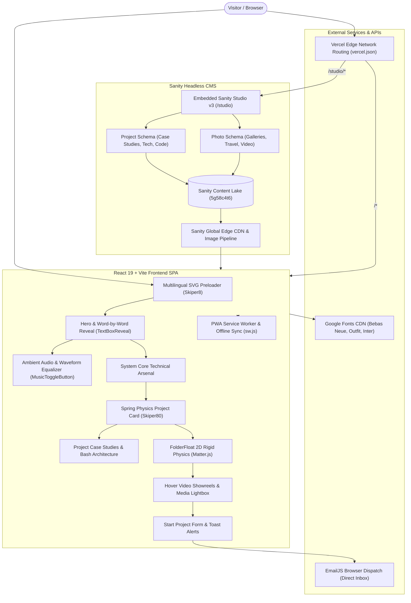

# Siva Harsha Vardhan Reddy: Interactive Developer Portfolio & Creative Showcase

[](https://sivaharshavardhanreddys-portfolio.vercel.app/)
[](https://github.com/harsha08-2k6/Portfolio)

[](https://react.dev)
[](https://vite.dev)
[](https://www.sanity.io)
[](https://brm.io/matter-js/)
[](https://www.framer.com/motion/)
[](https://greensock.com/gsap/)
[](https://www.emailjs.com/)
[](https://web.dev/progressive-web-apps/)
[](https://sivaharshavardhanreddys-portfolio.vercel.app/)

**Live Application:** [https://sivaharshavardhanreddys-portfolio.vercel.app/](https://sivaharshavardhanreddys-portfolio.vercel.app/)  
**Content Studio:** [https://sivaharshavardhanreddys-portfolio.vercel.app/studio](https://sivaharshavardhanreddys-portfolio.vercel.app/studio)  
**GitHub Repository:** [https://github.com/harsha08-2k6/Portfolio](https://github.com/harsha08-2k6/Portfolio)

---

**Siva Harsha's Portfolio** is a high-performance, full-stack personal portfolio, creative showcase, and headless CMS content platform built for **Tamlampudi Siva Harsha Vardhan Reddy** — Full Stack Developer, Video Editor, and Cybersecurity Enthusiast.

Unlike conventional static resume pages, this portfolio functions as an interactive web experience. It combines 2D rigid-body physics simulations (`matter-js`), cursor-tracking spring mechanics (`framer-motion`), procedural canvas character animations (`gsap`), background ambient audio with real-time animated waveform visualizers, dynamic headless content management via embedded **Sanity Studio v3**, and offline-first Progressive Web App (PWA) resilience with automated build-time cache manifest generation.

---

## 🏛️ System Architecture

The application is structured into a React single-page frontend with micro-animations and physics layers, an embedded Sanity Studio v3 dashboard running under `/studio`, cloud-based Sanity Content Lake storage with GROQ querying, and a serverless EmailJS dispatch pipeline.



*The diagram represents the principal application architecture, CMS data pipelines, and client-side physics runtimes.*

---

## ✨ Key Capabilities

### 🪐 2D Rigid-Body Physics Engine (`FolderFloat`)
- **Matter.js Physical World:** Interactive floating notes powered by 2D physics engine `matter-js` with gravity calculations, restitution bounce, inertia, and drift forces.
- **Pointer Drag & Throw Dynamics:** Real-time pointer capture allows visitors to pick up, throw, and collide interactive pills inside constrained physical bounding walls.
- **Adaptive Reduced Motion:** Listens to `prefers-reduced-motion` media queries and gracefully halts physics simulation for accessible browsing.

### 🎯 Spring Physics Floating Showcase (`Skiper80Showcase`)
- **Buttery Cursor Tracking:** Floating project card smoothly follows user cursor coordinates using Framer Motion springs (`damping: 22`, `stiffness: 180`, `mass: 0.55`).
- **Interactive Drag-to-Inspect:** Users can drag preview cards anywhere across the viewport without snapping back while interacting.
- **Clamped Viewport Boundaries:** Bounds tracking prevents floating preview cards from clipping past viewport edges.

### 🎨 Headless Content Management (Sanity Studio v3)
- **Embedded Studio Route:** Content editors can access the full visual CMS dashboard at `/studio` without third-party portal redirection.
- **Dynamic Project Schemas:** Manages case studies with metadata, live preview URLs, GitHub repositories, client names, industry tags, code architecture file trees, and challenges/solutions.
- **Multi-Asset Photo & Travel Archive:** Dedicated photo schema supporting multi-image uploads, categorized tags (`Photos`, `Travel`, `Videos`), and high-res video streaming.
- **Ultra-Fast GROQ Queries:** Sub-100ms response times delivered via Sanity's global edge caching CDN.

### 🎵 Ambient Audio Player & Waveform Equalizer
- **Skiper25 Audio Component:** Background track playback (`/song.mp3`) with an interactive floating toggle button.
- **Reactive Dancing Equalizer Bars:** Real-time animated waveform height simulation reacting continuously while audio is playing.
- **Lifecycle Cleanliness:** Safely disposes audio instances on unmount and pauses immediately on `beforeunload` events.

### 🎬 Creative Video Showreels & Media Lightbox
- **Hover-to-Play Video Cards:** Demonstrates video editing reels on hover with auto-restart, seamless loop cycling, and fallback to muted autoplay.
- **Custom Sound Controls:** Interactive per-card mute/unmute buttons overlaying video preview frames.
- **Keyboard-Navigated Lightbox:** Fullscreen modal lightbox supporting arrow keys (`ArrowLeft`, `ArrowRight`) to cycle through multi-image galleries and `Escape` to close.

### 💻 Comprehensive Case Studies & Architecture Breakdown
- **Code Structure File Trees:** Interactive terminal bash-style code editors displaying project directory structures with macOS window controls.
- **Challenges & Solutions Matrix:** Dedicated sections highlighting real-world engineering hurdles and architectural resolutions for each project.
- **Dynamic Markdown Parsing:** Employs `react-markdown` and `rehype-raw` for rich markdown formatting.

### 📬 Serverless Contact Pipeline (`StartProject`)
- **Direct EmailJS Browser Integration:** Dispatches visitor inquiries straight to developer email inbox without a custom backend server.
- **Form Validation & Toast Alerts:** Real-time validation with floating SVG toast feedback alerts (success, error, and informational).
- **Persistent WhatsApp CTA:** Floating direct link initiating instant messaging with pre-composed inquiries.

### ⚡ Progressive Web App (PWA) & Offline Resilience
- **Automated Postbuild Cache Injection:** Custom `postbuild.js` pipeline automatically analyzes hashed assets in `dist/assets` and injects them into `dist/sw.js`.
- **Live Connection State Detection:** Native `online` / `offline` event listeners display a custom offline error screen with retry capabilities.
- **Error Simulation Mode:** Includes a dev-mode simulation bar (`?dev=true`) to test 404, offline, and timeout states interactively.

### 🎭 Procedural Crowd Canvas Animation (`Skiper39`)
- **GSAP Canvas Sprite Simulation:** Renders walking character sprites from a Peeps illustration sprite sheet using custom GSAP easing functions.
- **Dynamic Character Generation:** Grounded randomized trajectories, continuous scaling, and automatic stage resize handling.

---

## 🛠️ Technology Stack

| Layer | Technologies | Purpose |
|---|---|---|
| **Frontend Framework** | React 19 (`react`, `react-dom` `^19.2.6`) | Component-based, concurrent rendering UI architecture |
| **Build Tool & Bundler** | Vite 8 (`^8.0.12`), `@vitejs/plugin-react` | Ultra-fast development server, HMR, and Rollup build pipeline |
| **Physics Engine** | Matter.js (`^0.20.0`) | 2D rigid-body physical simulations, drift forces, collisions, and drag dynamics |
| **Motion & Spring Physics** | Framer Motion (`^14.3.0`) | Smooth spring cursor tracking, modal layout transitions, and entrance/exit animations |
| **Canvas & Tweens** | GSAP 3 (`^3.15.0`) | High-performance canvas character sprite animations and easing math |
| **Headless CMS Studio** | Sanity Studio v3 (`^6.18.0`), `@sanity/vision` | Real-time content editing studio embedded at `/studio` |
| **CMS Client & Images** | `@sanity/client` (`^8.9.0`), `@sanity/image-url` | Fast GROQ query execution, CDN caching, and responsive image URL builder |
| **Markdown Parsing** | `react-markdown` (`^10.1.0`), `rehype-raw` (`^7.0.0`) | Rich markdown case study rendering and HTML sanitization |
| **Communications** | `@emailjs/browser` (`^5.0.2`) | Serverless client-side email dispatching for project inquiry forms |
| **Iconography** | Lucide React (`^1.59.0`), Custom SVG Sprites | Clean, scalable vector icons across modals, buttons, and links |
| **Styling & Design System** | Vanilla CSS, CSS Variables, Glassmorphism | Bespoke dark cyberpunk theme, micro-animations, and responsive layouts |
| **PWA & Offline** | Service Worker (`sw.js`), `postbuild.js` | Automated asset caching, offline fallback screen, and network listeners |
| **Hosting & Routing** | Vercel (`vercel.json`) | Global CDN hosting, multi-service rewrites between React SPA and Sanity Studio |
| **Version Control** | Git, GitHub | Distributed version control and CI/CD deployment pipelines |

---

## 📂 Repository Structure

```text
portfolio-react/
├── public/                      # Static assets served at root
│   ├── images/peeps/            # Sprite sheets for GSAP crowd canvas simulation
│   ├── favicon.svg              # Custom SVG browser tab icon
│   ├── hero.webp / hero.png     # Optimized hero portrait images
│   ├── icons.svg                # Inline SVG symbol definitions
│   ├── llms.txt                 # Structured markdown summary for AI & LLM crawlers
│   ├── resume.html              # Standalone high-contrast responsive resume
│   ├── resume.pdf               # Downloadable PDF resume
│   ├── song.mp3                 # Background audio track for music player
│   ├── sw.js                    # Service worker script with caching strategies
│   └── video1.mp4 - video3.mp4  # Showcase video reel preview files
│
├── src/                         # React 19 application source code
│   ├── assets/                  # Bundled assets and image imports
│   ├── components/              # Modular UI components
│   │   ├── FolderFloat/         # 2D physics-based floating folder
│   │   │   ├── FolderFloat.css
│   │   │   └── FolderFloat.jsx
│   │   ├── PhotoArchive/        # Media gallery with modal lightbox
│   │   │   ├── PhotoArchive.css
│   │   │   └── PhotoArchive.jsx
│   │   ├── About.jsx            # Bio, animated count-up statistics & infinite marquee
│   │   ├── AllProjects.jsx      # Complete projects archive page
│   │   ├── Contact.jsx          # Contact footer with magnetic CTA buttons
│   │   ├── Cursor.jsx           # Custom glowing cursor follower
│   │   ├── Demos.jsx            # Video showcase reels with sound controls
│   │   ├── Footer.jsx           # Compact footer branding
│   │   ├── Hero.jsx             # Hero section with role typewriter & audio toggle
│   │   ├── InfoDocument.jsx     # Privacy Policy and Terms & Conditions viewer
│   │   ├── MusicToggleButton.jsx# Ambient audio player with live equalizer bars
│   │   ├── Navbar.jsx           # Responsive sticky navigation bar
│   │   ├── NotFound.jsx         # 404 page & offline connection error handler
│   │   ├── ProjectDetails.jsx   # In-depth project case study view
│   │   ├── Projects.jsx         # Featured projects grid loaded from Sanity
│   │   ├── Skiper39.jsx         # GSAP procedural crowd canvas component
│   │   ├── Skiper80Showcase.jsx # Spring physics cursor-following project preview
│   │   ├── Skiper8Preloader.jsx # Multilingual greeting loader with SVG slide-up
│   │   ├── StartProject.jsx     # Project inquiry form powered by EmailJS
│   │   ├── TechnicalArsenal.jsx # System core interactive skill matrix
│   │   ├── TextBoxReveal.jsx    # Word-by-word tokenized reveal animation
│   │   └── WhatsAppFloat.jsx    # Persistent floating WhatsApp connect button
│   ├── hooks/
│   │   └── useScrollReveal.js   # IntersectionObserver scroll animation hook
│   ├── App.css                  # Core component layouts & utility classes
│   ├── App.jsx                  # Root state coordinator and preloader manager
│   ├── client.js                # Sanity client connection & image URL builder
│   ├── index.css                # Global styles, typography & color variables
│   ├── main.jsx                 # Application entry point
│   └── sanityClient.js          # Sanity client reference instance
│
├── studio/                      # Embedded Sanity Studio v3 project
│   ├── schemaTypes/             # Sanity data schemas
│   │   ├── index.js             # Schema exports aggregator
│   │   ├── photo.js             # Media & photo gallery schema
│   │   └── project.js           # Project case study schema
│   ├── sanity.cli.js            # Sanity CLI configuration
│   ├── sanity.config.js         # Sanity Studio dashboard configuration
│   └── package.json             # Sanity Studio dependencies
│
├── index.html                   # HTML template with font preloads & Netlify form
├── package.json                 # Root dependencies and npm scripts
├── postbuild.js                 # Service worker cache manifest generator
├── vercel.json                  # Multi-service proxy & routing configuration
└── vite.config.js               # Vite build config with Rollup chunk splitting
```

---

## 🚀 Quick Start Guide

### Prerequisites

Ensure you have the following installed on your machine:
- **Node.js 18+**
- **npm** or **pnpm** / **yarn**
- **Git**

---

### Option A: Complete Project Setup (Recommended)

From the project root:

```bash
# 1. Clone repository
git clone https://github.com/harsha08-2k6/Portfolio.git
cd Portfolio

# 2. Install root frontend dependencies
npm install

# 3. Install Sanity Studio dependencies
cd studio
npm install
cd ..

# 4. Launch the Vite development server
npm run dev
```

Open your browser at `http://localhost:5173`.

---

### Option B: Running Sanity Studio Locally

To manage portfolio content locally using the Sanity Studio dashboard:

```bash
cd studio
npm run dev
```

- **Sanity Studio Dashboard:** `http://localhost:3333`
- **Vision Playground:** Built into the Studio header for executing and testing GROQ queries.

---

### Option C: Production Build & PWA Testing

To test the production build with automated service worker cache injection:

```bash
# 1. Run Vite build and execute postbuild.js
npm run build

# 2. Preview the compiled production build
npm run preview
```

---

## 📡 Core Functional Modules

| Module | Primary Responsibility |
|---|---|
| **Skiper8Preloader** | Cycles multilingual greetings and triggers an elastic SVG curved-path slide-up exit transition |
| **Hero & TextBoxReveal** | Runs typewriter title loops, word-by-word tokenized reveals, and hosts the ambient music toggle |
| **MusicToggleButton** | Manages background audio playback (`/song.mp3`) and animates equalizer bars in real time |
| **TechnicalArsenal** | Interactive matrix displaying technical skills with cross-category synchronized glowing highlights |
| **Skiper80Showcase** | Follows cursor via Framer Motion spring physics with drag-to-inspect and modal case study triggers |
| **Sanity Content Client** | Executes GROQ queries, fetches project records, and builds responsive image URLs via CDN |
| **FolderFloat** | Simulates 2D rigid-body physical gravity, drift, and throw physics via Matter.js |
| **Demos & PhotoArchive** | Renders hover video cards with custom mute buttons and fullscreen multi-image lightbox |
| **ProjectDetails** | Displays in-depth project briefs, terminal bash code trees, tech pills, and challenges/solutions |
| **StartProject** | Validates client inputs, dispatches emails via EmailJS, and displays animated toast confirmations |
| **Service Worker & PWA** | Caches critical assets, listens to online/offline state, and delivers offline error screens |
| **InfoDocument** | Displays formatted Privacy Policy and Terms & Conditions documents in interactive modals |

---

## 🌐 Live Deployment

The portfolio is deployed and active in production:

- **Frontend Deployment (Vercel):** [https://sivaharshavardhanreddys-portfolio.vercel.app/](https://sivaharshavardhanreddys-portfolio.vercel.app/)
- **Embedded Studio (Sanity):** [https://sivaharshavardhanreddys-portfolio.vercel.app/studio](https://sivaharshavardhanreddys-portfolio.vercel.app/studio)
- **Source Repository:** [https://github.com/harsha08-2k6/Portfolio](https://github.com/harsha08-2k6/Portfolio)

### Vercel Multi-Service Routing
The project uses Vercel's multi-service architecture via [`vercel.json`](file:///d:/portfolio-react/vercel.json):
```json
{
  "$schema": "https://openapi.vercel.sh/vercel.json",
  "services": {
    "app": { "root": ".", "framework": "vite" },
    "studio": { "root": "studio", "framework": "sanity" }
  },
  "rewrites": [
    { "source": "/studio/(.*)", "destination": { "service": "studio" } },
    { "source": "/studio", "destination": { "service": "studio" } },
    { "source": "/(.*)", "destination": { "service": "app" } }
  ]
}
```
- Requests to `/studio` are dynamically served by the Sanity Studio service.
- All other application routes are handled by the main React Vite application.

### Production Checklist
- [x] Configure Sanity Project ID (`5g58c4t6`) and `production` dataset.
- [x] Configure EmailJS keys (`SERVICE_ID`, `TEMPLATE_ID`, `PUBLIC_KEY`).
- [x] Manual Rollup chunking enabled for `vendor-framer`, `vendor-sanity`, and `vendor-react`.
- [x] Verify PWA service worker asset injection via `postbuild.js`.
- [x] Enable SSL/TLS certificates and HTTPS encryption across all routes.
- [x] High-contrast accessibility compliance and Google Fonts preloading.

---

## 🔐 Security & Performance

- **Zero Server-Side Secret Leakage:** Uses client-safe public keys for EmailJS and public Sanity CDN read tokens.
- **Rollup Code Splitting:** Heavy vendor packages (`framer-motion`, `@sanity`, `react`) are separated into standalone chunks in `vite.config.js` to ensure fast initial page loads.
- **Font & Asset Preloading:** Critical font files (`Bebas Neue`, `Inter`, `Outfit`) and hero images are preloaded in `index.html` to prevent layout shifts (CLS).
- **Graceful Offline Degradation:** If internet connectivity drops, the application detects network changes instantly and serves an interactive offline fallback with reconnect retry capabilities.

---

## 🎯 Project Objectives

- **Break Beyond Traditional Portfolios:** Replace static, text-heavy developer templates with an engaging, interactive creative experience.
- **Merge Web Engineering with Real Physics:** Demonstrate real-time 2D physics simulations (`matter-js`) and spring motion (`framer-motion`) directly in a web environment.
- **Empower Real-Time Content Authoring:** Integrate a headless CMS (Sanity v3) allowing instant project updates without requiring redeployments.
- **Showcase Multi-Disciplinary Skills:** Highlight competencies across full-stack web development, video editing showreels, and cybersecurity practices under a unified roof.
- **Deliver Sub-Second Performance:** Maintain fast load times, automated PWA caching, and responsive design across all devices.

---

## 🔮 Future Improvements

- [ ] **Interactive 3D WebGL Hero:** Three.js / React Three Fiber interactive 3D model replacing 2D imagery.
- [ ] **Technical Blog via Sanity:** Dedicated engineering blog section powered by Sanity CMS schemas.
- [ ] **Live GitHub Statistics Widget:** Real-time commit counter and repository activity graph fetched directly via GitHub REST API.
- [ ] **Theme Customizer:** Accent color picker allowing visitors to switch between cyber-mint, electric-purple, and sunset-amber palettes.
- [ ] **Interactive Terminal Playground:** In-browser mini CLI allowing visitors to run commands like `cat skills.txt` or `ping harsha`.

---

## 🤝 Contributing

Contributions, bug reports, and suggestions are welcome!

1. Fork the repository: `https://github.com/harsha08-2k6/Portfolio`
2. Create a feature branch: `git checkout -b feature/amazing-feature`
3. Commit your changes: `git commit -m "feat: add amazing feature"`
4. Push to the branch: `git push origin feature/amazing-feature`
5. Open a Pull Request describing your changes.

---

## 📄 License

This project is licensed under the **MIT License** - see the `LICENSE` file for details. Built with care by **Tamlampudi Siva Harsha Vardhan Reddy**.

---

## ⭐ Support & Connect

If you find this portfolio inspiring or useful for your own projects, please give the repository a **Star** on GitHub!

- **Live Application:** [https://sivaharshavardhanreddys-portfolio.vercel.app/](https://sivaharshavardhanreddys-portfolio.vercel.app/)
- **GitHub Profile:** [@harsha08-2k6](https://github.com/harsha08-2k6)
- **LinkedIn Profile:** [in/siva-harsha-vardhan-reddy](https://www.linkedin.com/in/siva-harsha-vardhan-reddy/)
- **X (Twitter):** [@harsha08_2k6](https://x.com/harsha08_2k6)
- **Instagram:** [@_name_is_harsha_](https://www.instagram.com/_name_is_harsha_/)
- **Direct Email:** [tsivaharshavardhanreddy08@gmail.com](mailto:tsivaharshavardhanreddy08@gmail.com)
